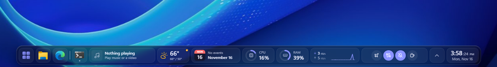
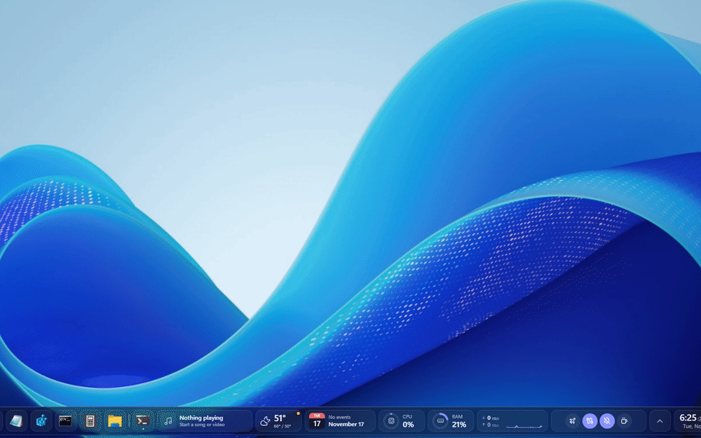
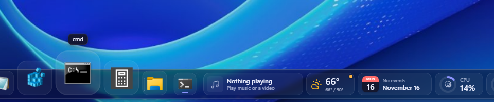
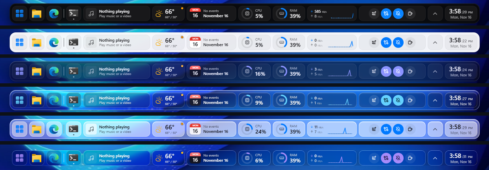
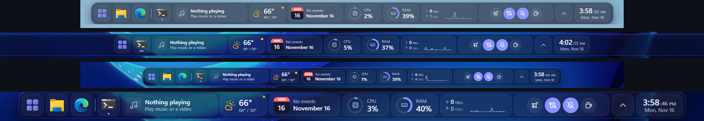
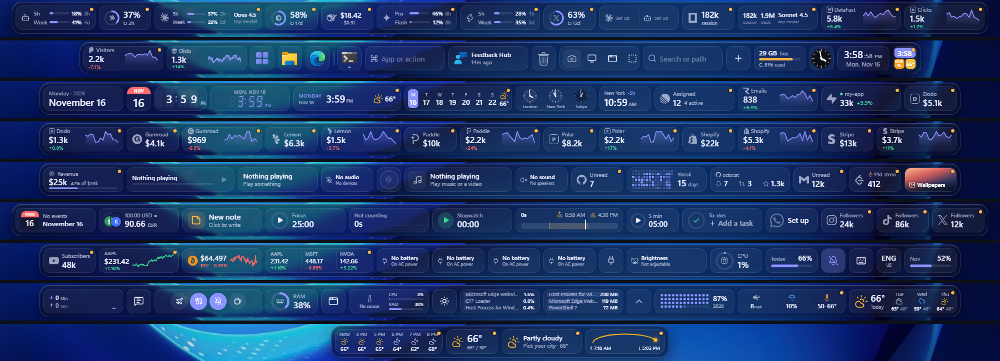
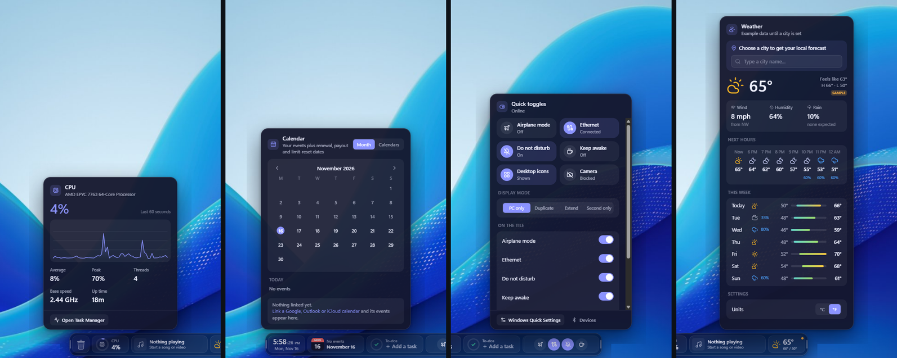
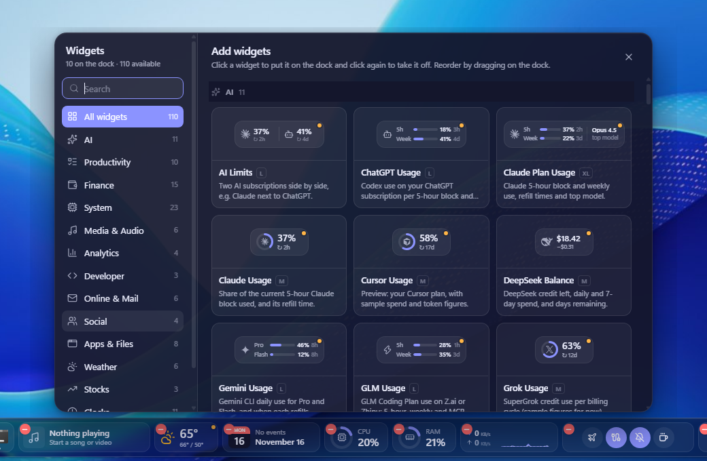
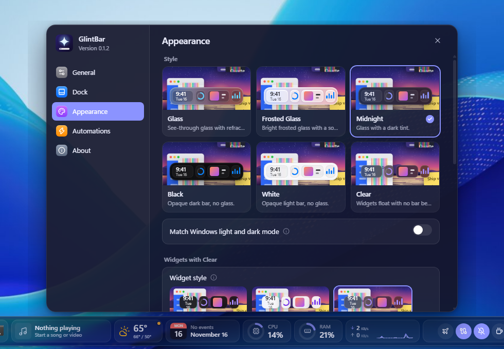
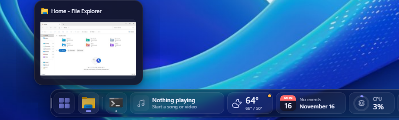

<h1 align="center">GlintBar</h1>

<p align="center">GlintBar replaces the Windows 10 and 11 taskbar with a dock that shows live information next to your apps.</p>

<p align="center"></p>

The dock holds your pinned and running apps together with widgets for media playback, weather, upcoming calendar events, CPU, memory, network speed, quick toggles, clocks, timers and to-dos. Account widgets cover AI plan limits, revenue, analytics, GitHub, mail and follower counts. Clicking a widget opens a card with more detail and its options.

<p align="center"></p>

## Highlights

- **110 widgets** across 13 categories. Pick the ones you want and arrange them in any order.
- **Taskbar features.** Pinned and running apps, hover previews of windows, right-click jump lists, a Start button, tray icons, and space reserved so maximised windows don't cover the dock.
- **Top or bottom, pill or full width.** Three preset sizes and a height slider, adjustable spacing and padding, left / centre / right alignment or Fill (widgets stretch edge to edge), auto-hide, and either a dock on each display or a single dock that moves between displays with the pointer.
- **Six themes**, two of them glass, and an accent colour of your choice.
- **Magnification.** Icons under the pointer enlarge and extend past the top of the bar.
- **Quiet.** The dock hides itself on any display where a full-screen game or video is running, and idles at well under 1 % CPU.
- **Private.** Nothing to sign up for, no telemetry and no GlintBar server. Pasted keys are stored in Windows Credential Manager.
- **No system changes.** Runs without administrator rights and modifies no system files. Your taskbar returns to normal as soon as GlintBar exits.

## Screenshots

These were captured on a Windows machine during the automated test run. Tiles for online accounts show sample numbers, marked with a small dot, until you connect them.

**Magnification**



**Themes** (top to bottom: Black, White, Midnight, Glass, Frosted Glass, Clear)



**Layouts** (top to bottom: docked at the top edge, full width with centred widgets, small, large)



**Every widget**



**Cards** (click a widget: CPU, calendar, quick toggles, weather)



**Widget picker**



**Settings**



**Window previews**



## Widgets

| Category | Count | What is in it |
|---|---:|---|
| System | 23 | CPU, memory, top processes, network, temperature, five battery styles, brightness, quick toggles, tray, keyboard layout, theme switch, do not disturb, day / month / year progress |
| Finance | 15 | Stripe, Polar, Shopify, Paddle, Lemon Squeezy, Gumroad and Dodo Payments, each as a number and as a chart, plus total revenue with a monthly goal |
| AI | 11 | Plan limits and reset times for Claude, ChatGPT, Gemini, GLM, DeepSeek and OpenCode; two tools on one tile |
| Clocks | 11 | Analog, digital, flip and seven-segment clocks, world clocks, date tiles, a week strip |
| Productivity | 10 | Calendar, to-dos, notes, pomodoro, timer, stopwatch, currency converter, screen time, day timeline, WhatsApp unread |
| Apps & Files | 8 | Apps, any app or folder as its own tile, recently opened, recycle bin, search, commands, storage, screenshot capture |
| Media & Audio | 6 | Four now-playing styles, output volume with a per-app mixer, microphone mute |
| Weather | 6 | Current conditions, details, hourly, forecast, sunrise and sunset |
| Online & Mail | 6 | Gmail, GitHub notifications, activity and overview, LeetCode, wallpaper gallery |
| Analytics | 4 | Search Console, Plausible, DataFast, Dub |
| Social | 4 | X, YouTube, Instagram, TikTok |
| Developer | 3 | Linear, Resend, Supabase |
| Stocks | 3 | Stock chart, watchlist, crypto |

## Install

1. Open the latest release on the [Releases page](../../releases/latest) and download an installer:
   - `GlintBar_<version>_x64-setup.exe` installs for your user only and needs no administrator rights (recommended).
   - `GlintBar_<version>_x64_en-US.msi` installs for the whole machine.
2. Run it. The installer is not code-signed, so Windows SmartScreen shows "Windows protected your PC". Click **More info**, then **Run anyway**.
3. Start GlintBar from the Start menu. To start it when you sign in, switch on Settings > General > Launch at startup.

Or install with [Scoop](https://scoop.sh/):

```sh
scoop bucket add glintbar https://github.com/candiesdoodle/glintbar
scoop install glintbar
```

GlintBar needs a 64-bit (x64) PC with Windows 10 or 11. The installer adds Microsoft Edge WebView2 if it is missing.

Updating works by installing a newer version on top of the current one, and your settings carry over. To remove GlintBar, open Settings > Apps > Installed apps in Windows and uninstall it there. With Scoop, use `scoop update glintbar` and `scoop uninstall glintbar` instead.

## Getting started

- By default the dock sits along the bottom edge, and GlintBar hides the Windows taskbar for as long as it is running. To keep the taskbar, or to use its built-in auto-hide, change Settings > Dock > Taskbar.
- **Click** a widget to see its card. Clicking anywhere else or pressing Esc closes it.
- **Right-click** the dock to reach **Widgets…** (add or remove widgets), **Settings** and **Quit GlintBar**. A widget's right-click menu can remove it or connect its account.
- **Drag** widgets to change their order. To put the dock at the top instead, grab an empty part of it and drop it in the upper half of the screen.
- **Keyboard:** Alt+T shows your to-dos. Win+Alt+T gives the dock keyboard focus: arrow keys move between items, Enter opens one and Esc exits.

On first start the dock contains only widgets that need no setup: apps, now playing, weather, calendar, CPU, memory, network, quick toggles, tray and clock. The weather city is guessed from the PC's time zone.

## Connecting accounts

Until an online-service widget is connected, it displays sample numbers. Click it and its card lists the setup steps. Usually you generate an API key on the service's website and paste it in; where the service supports read-only keys, GlintBar asks for one.

| Widgets | How they connect |
|---|---|
| Revenue, analytics, developer, stocks, YouTube, Instagram | An API key or token you paste into the card |
| Claude, ChatGPT, Gemini, OpenCode | The sign-in of the official app or command-line tool already on this PC, read-only |
| Gmail, Search Console, X | Browser sign-in (OAuth) with a client you create; the card explains how |
| Calendar | The private iCal address of a Google, Outlook or iCloud calendar |
| WhatsApp | Windows notifications, after you allow GlintBar to read them |

Disconnecting a widget deletes its stored key.

## Privacy and data

GlintBar does not run a server, collect telemetry or require an account. Every widget sends its requests directly from your PC to its own service, using your key. Weather and city search come from [Open-Meteo](https://open-meteo.com/).

| What | Where |
|---|---|
| Settings, layout, notes, to-dos, screen time | `%APPDATA%\GlintBar` |
| Logs (never contain keys) | `%APPDATA%\GlintBar\logs` |
| API keys, tokens, calendar addresses | Windows Credential Manager |

Settings > General > Backup exports and imports your layout and settings, without keys. Screen Time counts only while its widget is on the dock, or when you switch on "Count all the time".

## Known limitations

- **Tray icons** are listed only on Windows 10 and early Windows 11. Newer Windows 11 versions keep them where other apps cannot read them; the widget then opens the Windows tray overflow instead.
- **Grok and Cursor** tiles are previews and show sample numbers, because those services give other apps no way to read plan usage.
- **X** needs your own app in the X developer portal.
- **Live glass** (off by default) refracts the screen content behind the dock. With it on, the dock does not appear in screenshots or screen recordings.
- **AI usage tiles** read your own sign-in through endpoints that those vendors do not document for third-party apps, so a tile can stop working when a vendor changes something.
- **No automatic updates**, and no build for ARM PCs.
- Battery, brightness, temperature, Bluetooth and Wi-Fi widgets need hardware that Windows exposes to apps. Where it does not, the widget says so.

## Development

GlintBar is built with Tauri 2 (Rust and WebView2), React 19, TypeScript and Tailwind. Each feature area owns one Rust service folder and one widget folder, and the two sides talk through a single generic call. [CLAUDE.md](CLAUDE.md) describes the architecture and how to add a widget or a service.

The UI runs in any browser against built-in sample data:

```sh
npm ci
npm run dev        # http://localhost:1420
```

Checks that run locally:

```sh
npx tsc --noEmit
npx vitest run
node scripts/check-ipc.mjs   # every call the UI makes exists in Rust
```

Rust is compiled on GitHub Actions, by manual trigger only:

- **Check** runs the TypeScript checks, `cargo check` and the Rust unit tests.
- **Build** produces the installers and then runs the app on the Windows runner. A script drives it with the real mouse and keyboard: cards, menus, typing, hotkeys, launching apps, drags, auto-hide, full screen, live glass, taskbar modes, idle CPU and crash recovery. It also calls every read-only service and renders every widget. The results land in the `glintbar-smoke` artifact; `summary.md` is the file to read.

The installers on the Releases page come from a Build run that passed the smoke test.

## Licence

GlintBar is released under the [MIT licence](LICENSE). The libraries and data services it uses keep their own licences; see [THIRD_PARTY_NOTICES.md](THIRD_PARTY_NOTICES.md).

## More

- [Changelog](CHANGELOG.md)
- [Third-party notices](THIRD_PARTY_NOTICES.md)
